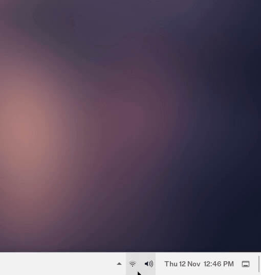

# Shopno Quick Settings

<p>
  <a href="https://github.com/fa-saikat/xfce4-shopno-quicksettings-plugin/releases/latest"></a>
  <a href="https://github.com/fa-saikat/xfce4-shopno-quicksettings-plugin/actions/workflows/build.yml"></a>
  
  <a href="COPYING"></a>
</p>

A Windows 11-style quick settings flyout and system tray for the Xfce panel:
Wi-Fi, Ethernet, Bluetooth, Do not disturb, Night light, brightness,
volume and battery in one place, behind one set of icons on the panel,
with other apps' tray icons next to them.

<a href="#features">Features</a> ·
<a href="#requirements">Requirements</a> ·
<a href="#installing">Install</a> ·
<a href="#building">Build</a> ·
<a href="#limitations">Limitations</a> ·
<a href="#credits">Credits</a>

> [!NOTE]
> Shopno Quick Settings is young. It works, but expect rough edges, and please
> [report them](https://github.com/fa-saikat/xfce4-shopno-quicksettings-plugin/issues/new/choose).

## Why this exists

I built it for [ShopnoOS](https://github.com/fa-saikat/shopno-os), alongside
[Shopno Menu](https://github.com/fa-saikat/xfce4-shopno-menu-plugin). Xfce
spreads these controls over separate applets (nm-applet, Blueman, the
PulseAudio plugin, the power manager plugin), each with its own icon and
menu. People coming from Windows expect one flyout. There wasn't one for
Xfce under a free license, so I made it.

## Features

**Panel button.** Network, volume and battery icons, like the Windows 11
taskbar. Scroll on it to change the volume; hover for a summary.

**System tray.** Tray icons of other apps, such as ibus, qBittorrent or
Telegram, sit left of the panel button, so Xfce's System Tray plugin is not
needed. Click an icon to open the app, middle-click for its second action,
right-click for its menu, scroll to scroll it. Icons of older apps that
use the XEmbed tray, such as ibus on Xfce, Wine and Java programs, show
too, drawn and clicked by the app itself. As on Windows 11, new apps wait
behind a **^** button that opens a small flyout of hidden icons; choose
which apps show on the panel, or not at all, in Properties. nm-applet's
icon is not shown by default, since the Wi-Fi tile does its job.

**Tiles**, three to a row. Split tiles have a chevron that opens a page.

- **Wi-Fi**: turns the radio on or off and shows the network you are
  connected to. Its page lists networks in range; click one to connect,
  type the password in place for a new one, or disconnect.
- **Ethernet**: shown while a cable is plugged in. Click it to disconnect,
  and again to connect. A disconnected cable stays off until you connect it
  again.
- **Bluetooth**: turns the adapter on or off, lifting an rfkill block if
  needed. Its page lists paired devices; click one to connect or disconnect.
- **Do not disturb**: holds back notification popups from xfce4-notifyd.
- **Night light**: warms the screen color. Stays on across restarts.

**Sliders.**

- **Brightness** of a laptop screen, or on desktop PCs of the external
  monitors over DDC/CI, with no extra programs needed. Hidden when neither
  can be changed. See [Monitor brightness](#monitor-brightness).
- **Volume**, with mute on the speaker icon. Its page picks the output device.

<p align="center">
  
</p>

**Footer.** Battery level and time remaining, and a button for all settings.

**Properties.** Choose which tiles to show, where each tray icon goes (on
the panel, behind ^, or not shown), the Night light color temperature, and
background blur.

## Requirements

Each part talks to a system service directly. A tile whose service is
missing is greyed out with a tooltip saying why.

| Part            | Uses                                                               |
|-----------------|--------------------------------------------------------------------|
| Wi-Fi, network  | NetworkManager                                                     |
| Bluetooth       | BlueZ                                                              |
| Volume          | PipeWire (with pipewire-pulse) or PulseAudio                       |
| Brightness      | Laptops: systemd-logind (or elogind 243 or newer). Desktops: a     |
|                 | monitor with DDC/CI turned on in its menu                          |
| Battery         | UPower                                                             |
| Do not disturb  | xfce4-notifyd                                                      |
| Night light     | An X11 session with XRandR                                         |
| Tray icons      | Apps that use StatusNotifierItem (KDE/AppIndicator tray icons), or |
|                 | the older XEmbed tray on X11                                       |

The **More … settings** links open nm-connection-editor, blueman-manager,
pavucontrol, xfce4-power-manager-settings and xfce4-settings-manager when
they are installed.

Remove Xfce's **System Tray** plugin from the panel: Shopno Quick Settings
shows tray icons itself, and with both, icons would show twice. Properties
warns when another tray is running.

Stop nm-applet and the Blueman applet from starting (**Settings > Session
and Startup > Application Autostart**), and remove the PulseAudio and power
manager plugins, to avoid duplicate icons. There is one thing they still do:
pairing a new Bluetooth device needs **More Bluetooth settings** (Blueman)
for now.

## Installing

Download the package for your distribution from the
[latest release](https://github.com/fa-saikat/xfce4-shopno-quicksettings-plugin/releases/latest),
then install it:

| Distribution             | File                         | Install with                                                    |
|--------------------------|------------------------------|-----------------------------------------------------------------|
| Debian 13                | `*.debian13_amd64.deb`       | `sudo apt install ./xfce4-shopno-quicksettings-plugin_*.deb`    |
| Ubuntu 24.04, Mint 22    | `*.ubuntu24.04_amd64.deb`    | `sudo apt install ./xfce4-shopno-quicksettings-plugin_*.deb`    |
| Fedora                   | `*.fc*.x86_64.rpm`           | `sudo dnf install ./xfce4-shopno-quicksettings-plugin-*.rpm`    |
| Arch Linux               | `*.pkg.tar.zst`              | `sudo pacman -U xfce4-shopno-quicksettings-plugin-*.pkg.tar.zst`|

Each release also has a `SHA256SUMS` file to check the downloads with
`sha256sum -c --ignore-missing SHA256SUMS`.

Then restart the panel (`xfce4-panel -r`), right-click it, choose
**Panel > Add New Items…**, and add **Shopno Quick Settings**.

## Building

Dependencies:

| Library                                          | Minimum version |
|--------------------------------------------------|-----------------|
| GTK                                              | 3.24            |
| libxfce4panel, libxfce4ui, libxfce4util, xfconf  | 4.18            |
| libnm                                            | 1.24            |
| libpulse, libpulse-mainloop-glib                 | 15.0            |
| libX11, libXrandr                                | any, RandR 1.2  |
| libdbusmenu-gtk3                                 | 16.04           |

You also need `meson`, `ninja`, a C compiler, and `gettext`.

**Debian / Ubuntu**

```sh
sudo apt install build-essential meson ninja-build gettext pkg-config \
  libgtk-3-dev libxfce4panel-2.0-dev libxfce4ui-2-dev libxfce4util-dev libxfconf-0-dev \
  libnm-dev libpulse-dev libx11-dev libxrandr-dev libdbusmenu-gtk3-dev
```

**Fedora**

```sh
sudo dnf install gcc meson ninja-build gettext gtk3-devel \
  xfce4-panel-devel libxfce4ui-devel libxfce4util-devel xfconf-devel \
  NetworkManager-libnm-devel pulseaudio-libs-devel libX11-devel libXrandr-devel \
  libdbusmenu-gtk3-devel
```

**Arch Linux**

```sh
sudo pacman -S --needed base-devel meson gettext gtk3 xfce4-panel libxfce4ui libxfce4util xfconf \
  libnm libpulse libx11 libxrandr libdbusmenu-gtk3
```

Build and install:

```sh
meson setup build --prefix=/usr
meson compile -C build
sudo meson install -C build
```

The prefix must match the one Xfce is installed to (`/usr` on almost every
distribution), otherwise the panel will not find the plugin. After the first
install, restart once for [monitor brightness](#monitor-brightness).

## Monitor brightness

On a desktop PC, the brightness slider sets external monitors over DDC/CI,
the control channel in the video cable that most monitors support. The
plugin talks to the monitors itself, so nothing else needs to be installed.
With several monitors, the slider sets them all to the same level. On
laptops it sets the built-in screen, as before.

To get the slider:

1. Turn on **DDC/CI** in the monitor's own on-screen menu. Many monitors
   have it on already.
2. Restart once after installing. The plugin installs a udev rule that lets
   the logged-in user reach the graphics card's I2C buses, and loads the
   `i2c-dev` module at boot. To apply both without restarting:

   ```sh
   sudo modprobe i2c-dev
   sudo udevadm trigger --subsystem-match=i2c-dev
   ```

The slider shows the monitors' level when the flyout opens, and finds them
again after they are plugged in, turned on or wake from sleep. Only the
I2C buses of the graphics card are opened, never other devices on the
motherboard.

If the slider does not show, run the panel with debug messages to see what
the plugin finds on each bus:

```sh
xfce4-panel -q
G_MESSAGES_DEBUG=shopno-quicksettings xfce4-panel
```

`no EDID` means nothing answers on that connector, and `no DDC/CI answer`
means a monitor is there but DDC/CI is off or not supported.
`Permission denied` means the udev rule has not been applied yet. With the
NVIDIA driver, a DisplayPort monitor sometimes stops answering for a
while; the slider then sets the other monitors.

## Background blur

Blur is drawn by the compositor, so it needs [picom](https://github.com/yshui/picom)
instead of the built-in Xfce compositor:

1. Turn off the Xfce compositor in **Settings > Window Manager Tweaks >
   Compositor**, and run picom with a blur method such as
   `blur-method = "dual_kawase";`.
2. Add the rules from
   [`extras/picom/shopno-quicksettings.conf`](extras/picom/shopno-quicksettings.conf)
   to your picom configuration.
3. Right-click the panel button, choose **Properties**, and turn on **Blur
   the background behind the flyout**.

With blur off, the flyout works with any compositor, or none.

## Theming

Colors come from your GTK theme: active tiles and sliders use its accent
(selected) color. To change the layout or colors, override the
`.shopno-qs-*` CSS classes in `~/.config/gtk-3.0/gtk.css`. The default rules
are in
[`src/resources/shopno-quicksettings.css`](src/resources/shopno-quicksettings.css).

## Limitations

- **X11 only.** Night light and the input grab need X11.
- **No Bluetooth pairing yet.** Pairing new devices needs a PIN agent; use
  Blueman for that.
- **No enterprise Wi-Fi in the flyout.** 802.1X networks open
  nm-connection-editor.
- **One brightness slider.** On desktops it sets all monitors to the same
  level. On laptops it sets only the built-in screen, not external monitors.
- **Night light and redshift** both set the gamma ramps; use one of them.
- **No tile editing in the flyout.** Choose tiles in Properties instead.
- **XEmbed icons are the app's own.** Older apps draw and handle their
  icons themselves, so these do not light up on hover, and Escape does not
  close the ^ flyout while the pointer is on one of them.
- **No dragging of tray icons.** Choose which show on the panel in
  Properties.
- **Borrowed icon.** It uses the ShopnoOS logo until it has one of its own.

If one of these matters to you,
[open a feature request](https://github.com/fa-saikat/xfce4-shopno-quicksettings-plugin/issues/new/choose).

## Contributing

Bug reports, translations, and patches are welcome. See
[CONTRIBUTING.md](CONTRIBUTING.md).

## Credits

Shopno Quick Settings builds on:

- **Xfce**: the [panel plugin API](https://gitlab.xfce.org/xfce/xfce4-panel),
  [xfconf](https://gitlab.xfce.org/xfce/xfconf),
  [libxfce4ui](https://gitlab.xfce.org/xfce/libxfce4ui) and
  [libxfce4util](https://gitlab.xfce.org/xfce/libxfce4util), on
  [GTK 3](https://gtk.org/).
- The services it talks to: [NetworkManager](https://networkmanager.dev/)
  through libnm, [BlueZ](https://www.bluez.org/),
  [PulseAudio](https://www.freedesktop.org/wiki/Software/PulseAudio/) and
  [PipeWire](https://pipewire.org/), [UPower](https://upower.freedesktop.org/),
  systemd-logind and xfce4-notifyd.
- The system tray follows the code of Xfce's
  [systray plugin](https://gitlab.xfce.org/xfce/xfce4-panel/-/tree/master/plugins/systray)
  (GPL-2.0-or-later): its StatusNotifierItem part by Viktor Odintsev, and
  its XEmbed part by Anders Carlsson, Vincent Untz and Nick Schermer. It uses
  [libdbusmenu](https://launchpad.net/libdbusmenu) for apps' menus.
- Projects it learned from: [network-manager-applet](https://gitlab.gnome.org/GNOME/network-manager-applet),
  [xfce4-pulseaudio-plugin](https://gitlab.xfce.org/panel-plugins/xfce4-pulseaudio-plugin),
  [xfce4-power-manager](https://gitlab.xfce.org/xfce/xfce4-power-manager) and
  [redshift](https://github.com/jonls/redshift), and
  Tanner Helland's color temperature approximation.
- **Windows 11**, whose quick settings it imitates in layout only.

## License

Shopno Quick Settings is released under the
[GNU General Public License v2.0 or later](COPYING).

The icon in `data/icons/shopno-quicksettings.svg` is the ShopnoOS logo,
© 2026 JaduPc, licensed under the GNU General Public License v3.0 or later. It
stands in until Shopno Quick Settings has a logo of its own. ShopnoOS Linux is
a trademark of JaduPc.

Windows is a trademark of Microsoft Corporation. This project is not
affiliated with or endorsed by Microsoft.
